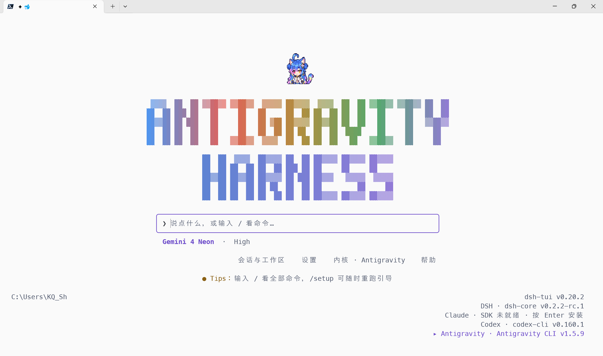
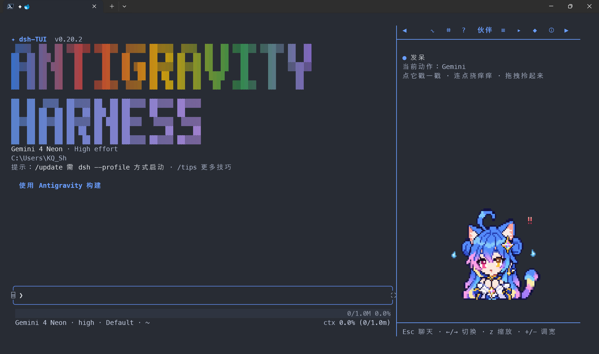
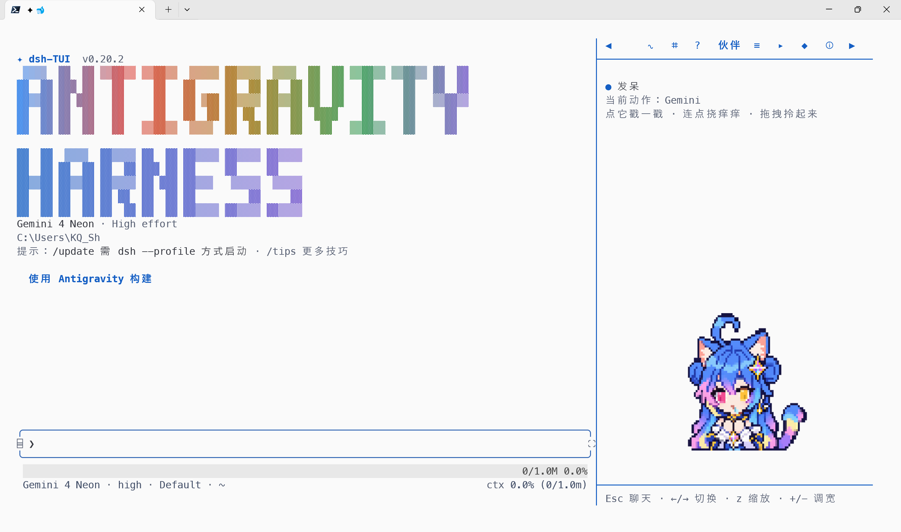

<div align="center">


# Antigravity Backend for dsh-TUI

**把 Gemini 接进你熟悉的终端，在 dsh-TUI 里无缝开工。**


[选择版本](#选择你的版本) · [快速安装](#快速安装) · [交给 Agent 安装](#交给-agent-安装) · [日常使用](#日常使用) · [外观预览](#主题与外观预览) · [卸载与切回](#卸载与切回原内核)

<br />



<sub>完整外观版首页预览（<b>Gemini Daylight</b> 浅色主题 · <code>ANTIGRAVITY HARNESS</code> 彩虹标题 · Gemini 像素娘）。<br />标准版与外观版均内置两套 Gemini 主题；专属标题与像素娘包含在完整外观版中。</sub>

</div>

---

已经在用 `agy` 了？装上这个社区插件后，只需在 [dsh-TUI](https://github.com/ccch1mneyyy/dsh-TUI) 的内核菜单里选 **Antigravity**，就能直接开启新任务，或者接上你原来的 Antigravity 会话。

- **原生协议接入**：通过官方 `agy acp` 桥接，标准版完全不改动宿主；两版均由 Antigravity CLI 管理登录态、工具执行与原生会话。
- **顺手的交互体验**：流式输出、工具审批、按 `Esc` 中断并保留输入，都在同一个熟悉的终端界面里完成。
- **双色主题与像素伴侣**：两版均内置 **Gemini Starlight**（深色）与 **Gemini Daylight**（浅色）主题；想要彩虹开屏标题和 22 动作像素猫猫，直接选完整外观版即可体验。

---

## 选择你的版本

两个版本均可在 [v0.5.3-rc.1 发布页](https://github.com/Emilia-tan-Ovo/dsh-tui-backend-antigravity/releases/tag/v0.5.3-rc.1) 直接下载，按你的使用习惯挑一个就好：

| 对比项 | 标准版（推荐日常） | 完整外观版（Windows 预览） |
| :--- | :--- | :--- |
| **后端与双主题** | `0.5.3-rc.1`，内置 Gemini Starlight / Daylight | 同一套后端与双主题 |
| **开屏与转录标题** | 沿用宿主原样 | 专属 `ANTIGRAVITY HARNESS` 彩虹标题 |
| **终端伙伴宠物** | 沿用宿主原样 | 开屏与侧栏 **Gemini 像素娘**（22 组动作） |
| **安装方式** | 作为插件装入现有 dsh-TUI，不改动宿主 | 解压到独立目录，脚本隔离运行，不影响原版 |
| **发布页附件** | `dsh-tui-backend-antigravity-0.5.3-rc.1.tgz` | `antigravity-appearance-0.5.3-rc.1-win.zip` |

---

## 快速安装

### 1. 确认基础环境（两版共用）

开始前，请确认你的 Windows 环境已备好以下工具：

- **PowerShell 7**（`PATH` 中可直接运行 `pwsh.exe`）
- **Node.js 22.19+（22.x）或 24+**
- **DSH CLI** 与 **pnpm**
- 已[按 Google 官方指南安装并登录 Antigravity CLI](https://antigravity.google/docs/getting-started?tab=cli)

可以在终端跑一下这两条命令，确认 `agy` 版本至少为 **1.5.0** 且支持 ACP：

```powershell
agy --version
agy acp --help
```

---

### 2A. 安装标准版

纯插件方案，不改动现有宿主。开始前请先装好并运行过一次 [dsh-TUI](https://github.com/ccch1mneyyy/dsh-TUI)。

> [!CAUTION]
> **请只安装你信任的插件包。** 本插件运行在 dsh-TUI 进程内，宿主不会单独为它提供沙箱；通过命令行安装时，TUI 内也不会再弹出信任确认。

1. 前往 [v0.5.3-rc.1 发布页](https://github.com/Emilia-tan-Ovo/dsh-tui-backend-antigravity/releases/tag/v0.5.3-rc.1)，下载插件包 **`dsh-tui-backend-antigravity-0.5.3-rc.1.tgz`**（注意选择发布附件里的 `.tgz`，**不要**下载 GitHub 自动生成的 **Source code** 压缩包）。
2. 在 PowerShell 中执行安装命令（把路径替换为 `.tgz` 实际所在的位置）：

```powershell
dsh plugin --profile dsh-tui add 'C:\Downloads\dsh-tui-backend-antigravity-0.5.3-rc.1.tgz'
```

3. 完全退出并**重启 dsh-TUI**，在**内核选择器**里选择 **Antigravity** 即可开工。

> [!NOTE]
> 标准版沿用宿主原有的开屏标题，确认是否切换成功请以**内核选择器显示的当前内核**为准。

---

### 2B. 安装完整外观版

包含 `ANTIGRAVITY HARNESS` 彩虹标题与 22 动作 Gemini 像素娘，并在独立目录中自动搭建隔离运行环境，**不会覆盖或升级你原有的 dsh-TUI**。

**额外环境要求：**

- **Git for Windows** 与 **`tar.exe`**
- **DSH CLI** 需为 **`0.2.2-rc.1`**（安装器会联网拉取固定的官方 `dsh-TUI 0.20.2` 制作独立副本）

**安装与启动步骤：**

1. 前往 [v0.5.3-rc.1 发布页](https://github.com/Emilia-tan-Ovo/dsh-tui-backend-antigravity/releases/tag/v0.5.3-rc.1)，下载 **`antigravity-appearance-0.5.3-rc.1-win.zip`**。
2. 将压缩包解压到一个打算长期保留的固定目录（例如 `D:\Tools\antigravity-appearance`）。
3. 进入包含 `appearance.ps1` 的目录，在 PowerShell 中依次运行：

```powershell
pwsh -NoProfile -File .\appearance.ps1 -Action Install
pwsh -NoProfile -File .\appearance.ps1 -Action Status
pwsh -NoProfile -File .\appearance.ps1 -Action Start
```

> [!TIP]
> **日常启动不用重装**：以后在任意项目目录打开终端，直接用**脚本的绝对路径**执行 `-Action Start` 即可在该项目中启动外观版，例如：
> ```powershell
> pwsh -NoProfile -File 'D:\Tools\antigravity-appearance\appearance.ps1' -Action Start
> ```

> [!NOTE]
> - **独立隔离**：外观版的宿主、profile 和外观配置均保存在解压目录的 `.appearance` 中，不覆盖标准版（pnpm 照常使用依赖缓存）。
> - **共享会话**：两版共用本机 `agy` 的登录态与原生会话，并会自动识别另一窗口已占用的会话。
> - **更新方式**：升级外观版时请另行解压新版本 ZIP，**不要**在 TUI 内执行 `/update`。
> - **素材与许可**：完整来源与许可说明见 [appearance/NOTICE.md](appearance/NOTICE.md)。

---

## 交给 Agent 安装

懒得手动敲命令？选好版本，把对应提示词整段发给你的 Coding Agent 就好：

<details>
<summary><b>标准版安装提示词（点击展开复制）</b></summary>

```text
请在本机 Windows 上安装 Antigravity Backend for dsh-TUI 标准版 0.5.3-rc.1。
只用这个 GitHub Release：https://github.com/Emilia-tan-Ovo/dsh-tui-backend-antigravity/releases/tag/v0.5.3-rc.1
下载附件 dsh-tui-backend-antigravity-0.5.3-rc.1.tgz（不要下载 Source code）。先检查 dsh-tui、PowerShell 7、Node.js 22.19+（22.x）或 24+、pnpm，以及 agy 1.5.0+ 和 agy acp --help。若已安装其他版本或当前有任务在跑，先告诉我，不要覆盖安装或结束进程。
确认环境后运行 dsh plugin --profile dsh-tui add '<下载文件的绝对路径>'，再用 dsh plugin --profile dsh-tui list --depth 0 核对已安装的版本。完成后告诉我如何重启并在内核菜单选择 Antigravity。不要改宿主文件、升级全局工具、操作登录或发送模型请求；缺依赖请列出缺项。
```

</details>

<details>
<summary><b>完整外观版安装提示词（点击展开复制）</b></summary>

```text
请在本机 Windows 上安装 Antigravity 完整外观版 0.5.3-rc.1（含 ANTIGRAVITY HARNESS 标题和 Gemini 像素娘）。
只从这个 GitHub Release 下载附件 antigravity-appearance-0.5.3-rc.1-win.zip：https://github.com/Emilia-tan-Ovo/dsh-tui-backend-antigravity/releases/tag/v0.5.3-rc.1（不要替换成标准版或自行拼补丁）。
先检查 PowerShell 7、Git for Windows、tar.exe、pnpm、Node.js 22.19+（22.x）或 24+、DSH CLI 0.2.2-rc.1，以及 agy 1.5.0+ 和 agy acp --help。将 ZIP 解压到一个独立的持久目录，在该目录运行 pwsh -NoProfile -File .\appearance.ps1 -Action Install，再运行 -Action Status 验证状态。
完成后告诉我安装目录以及可直接复制的、带脚本绝对路径的启动命令。请保留我原有的 dsh-tui、profile 和所有插件；不要运行 /update，不要改动登录状态，也不要发送模型请求。若检查未通过请直接报告原因，不要自行更换全局版本。
```

</details>

---

## 日常使用

| 场景 | 操作方式 | 说明 |
| :--- | :--- | :--- |
| **切换配色主题** | `/theme` | 两版均可手选 **Gemini Starlight**（深色）或 **Gemini Daylight**（浅色）。外观版在主题设为跟随品牌时也能自动匹配，手选始终优先。 |
| **继续历史会话** | `/resume` | 在原项目目录进入 Antigravity 后选择原生会话。恢复失败时会直接报错，不会悄悄新开会话顶替。 |
| **中断当前任务** | 按 `Esc` | 立即停止当前回复；输入区里尚未发出的排队消息会完整保留，确认后按 `Enter` 才会发送。 |
| **查看可用能力** | `/agy-commands` | 列出当前会话提供的原生命令。`/model`、`/effort` 与图片输入等能力取决于 `agy` 实际公布的列表。 |
| **调整工具权限** | `/permission` | 默认沿用 `agy` 自身配置，详见下方权限说明。 |

### 工具权限档位说明

当会话处于**空闲状态**且 CLI 支持原生恢复时，可以通过 `/permission` 临时调整工具权限：

- **工作区外访问**：关闭终端沙箱，但仍保留操作审批。
- **Full access**：关闭终端沙箱的同时跳过操作审批。

> [!WARNING]
> 建议仅在任务确有需要时再切到更高权限，任务完成后记得及时切回默认原生档。

---

## 主题与外观预览

两版均内置 **Gemini Starlight**（深色）与 **Gemini Daylight**（浅色）主题，可在 `/theme` 中随心切换：

| Gemini Starlight（深色） | Gemini Daylight（浅色） |
| :---: | :---: |
|  |  |

### 外观版专属 · Gemini 像素娘

<div align="center">

<table>
  <tr>
    <td align="center"><br /><sub>思考</sub></td>
    <td align="center"><br /><sub>听歌</sub></td>
    <td align="center"><br /><sub>庆祝</sub></td>
    <td align="center"><br /><sub>比心</sub></td>
    <td align="center"><br /><sub>打盹</sub></td>
  </tr>
</table>

</div>

完整外观版会在 Antigravity 内核的开屏与转录头部展示 **`ANTIGRAVITY HARNESS`** 彩虹标题，并在开屏和侧栏常驻 22 组动作的 Gemini 像素娘：

- 如果此前固定过品牌外观，在 `/settings` 里将品牌外观设为**「跟随后端」**即可显示专属标题；
- 在同一设置菜单中，将 Antigravity 专属宠物设为**「自动（Gemini）」**即可启用像素娘，选**「继承」**则可随时切回原宠物；
- 由于 dsh-TUI `0.20.2` 暂未开放第三方标题与皮肤接口，外观版通过独立的宿主副本实现上述外观，上游接口进展见[提案 #2067](https://github.com/ccch1mneyyy/dsh-TUI/discussions/2067)。

---

## 找不到 Antigravity？

- **内核菜单里没有这一项**
  确认插件已安装到 `dsh-tui` profile，并且已经完全关闭旧窗口后重新打开 dsh-TUI。
- **能看到选项，但提示未安装**
  重开终端确认 `agy` 已加入 `PATH`；也可以将环境变量 `DSH_TUI_AGY_COMMAND` 设为官方 `agy.exe` 的绝对路径（**注意**：变量值里不要带引号或额外参数）。
- **提示 CLI 版本过旧**
  升级到支持 ACP 的官方 Antigravity CLI（1.5.0+），升级后重启 dsh-TUI。

---

## 卸载与切回原内核

两版卸载都不会删除 `agy` 的任何原生会话，放心折腾：

### 卸载完整外观版

关闭外观版窗口后，直接删除外观版的整个解压目录即可，继续使用你原来的 `dsh-tui`。

> [!IMPORTANT]
> 请**不要**删除个人目录下的 `~/.dsh` 或 `~/.dsh-tui`。

### 卸载标准版

1. 等待当前任务结束（或按 `Esc` 停止），从内核菜单切回 **DSH** 或 **Codex**。
2. 如果之前切过 Gemini 主题，可先用 `/theme` 换回其他主题。
3. 退出 dsh-TUI，在 PowerShell 中执行：

```powershell
dsh plugin --profile dsh-tui remove dsh-tui-backend-antigravity
```

重新打开 dsh-TUI 即可继续使用原内核。

---

## 预览版验收范围

标准版的菜单切换、工具审批、停止后保留输入、原生会话恢复及卸载流程，已在以下环境通过离线 ACP 验收：

- **系统**：Windows
- **宿主与内核**：[dsh-TUI 0.20.2](https://github.com/ccch1mneyyy/dsh-TUI/releases/tag/v0.20.2) · DSH `0.2.2-rc.1`
- **运行时**：Node.js `24.18.1`

完整外观版在同一版本组合上完成了独立安装、开屏与转录标题、侧栏像素娘、切回 DSH，以及外观设置与恢复记录隔离验证。

---

## 反馈问题

使用中遇到任何问题或奇怪的表现，欢迎到[本仓库 Issues](https://github.com/Emilia-tan-Ovo/dsh-tui-backend-antigravity/issues) 告诉我们！提交时麻烦附上：

- 使用的版本（标准版 / 完整外观版）、插件版本、Windows 版本、dsh-TUI 版本、DSH 版本
- `agy --version` 的输出结果
- 最短复现步骤和完整报错信息

> [!IMPORTANT]
> 发布 Issue 前请记得脱敏，**删去凭据、会话正文和私人路径**。

---

## 从源码构建

```sh
pnpm install --frozen-lockfile
pnpm build
pnpm pack
```

上述命令用于构建标准版插件，构建完成后按[标准版安装步骤](#2a-安装标准版)安装生成的 `.tgz` 即可。

---

本项目代码基于 [MIT](LICENSE) 许可证开源，第三方依赖与源码参考声明见 [THIRD_PARTY_NOTICES.md](THIRD_PARTY_NOTICES.md)，外观版素材来源与许可见 [appearance/NOTICE.md](appearance/NOTICE.md)。
